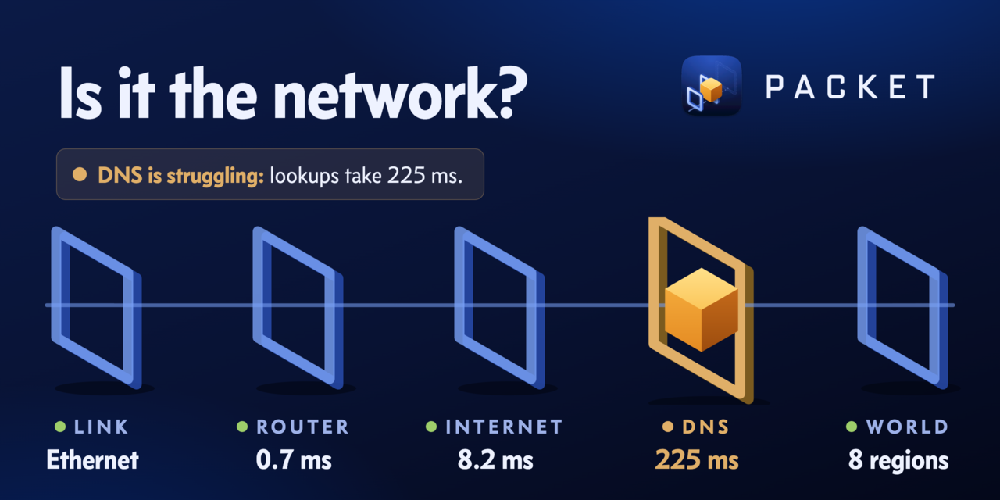
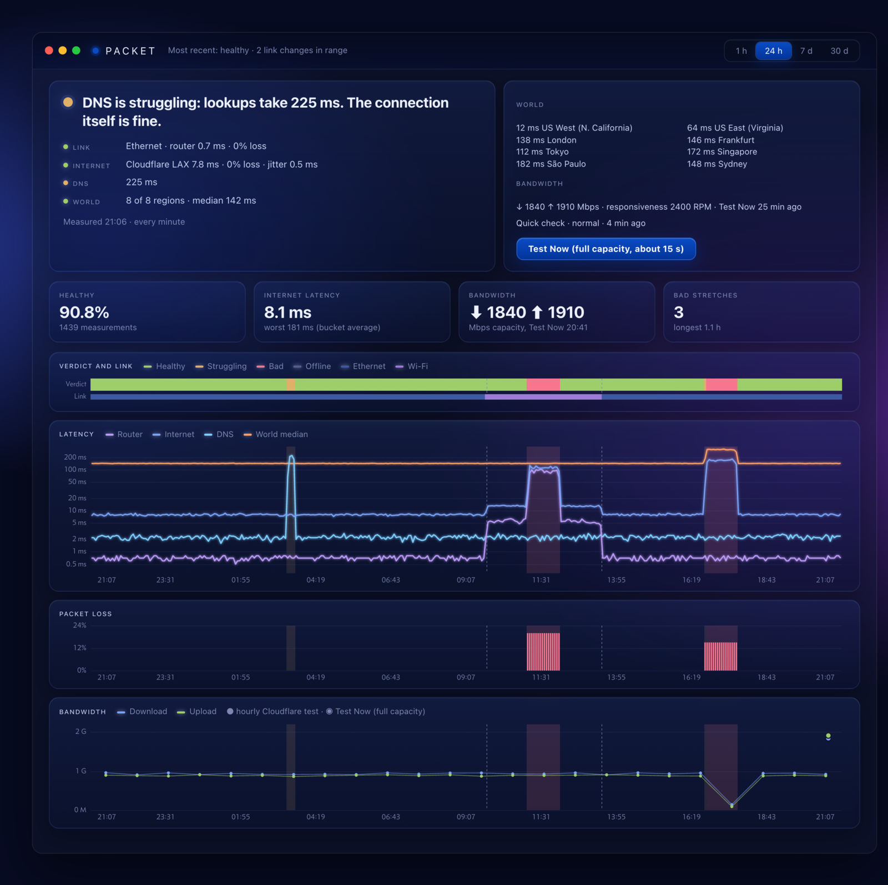

<p align="center">
  
</p>

<p align="center">
  <a href="https://github.com/danielmiessler/packet/actions/workflows/ci.yml"></a>
  
  
  <a href="LICENSE"></a>
</p>

# Packet

**Is it the network?** Packet lives in your Mac's menu bar, checks every layer of your connection once a minute, and tells you in one sentence which layer is to blame when things feel bad. When it's green, stop blaming the Wi-Fi and go look at the app.

## The problem

A video call stutters, a page hangs, a deploy times out. The first question is always the same: is it my network, or is it them? Usually there's no good way to answer it in the moment.

A speed test answers a different question. It measures how much your line can move at its peak, once, right now. Most bad experiences have little to do with peak bandwidth. They come from latency, packet loss, jitter and slow DNS, and they come from a specific place on the path: weak Wi-Fi in the back room, a router that's struggling, your provider having a bad hour, a resolver that has stopped answering quickly, or trouble on another continent.

Each of those has a different fix. Weak Wi-Fi means move closer or plug in. A provider problem means waiting or calling them. Slow DNS means changing resolvers. And if every layer is healthy, the network is off the hook and the problem is the app. A single "your internet is slow" number can't tell these apart, and by the time you open a terminal to run `ping`, the moment has usually passed. Nothing wrote down what the network was doing at 14:30 yesterday when the call kept dropping.

The usual tools each see one slice. `ping` and traceroute-style monitors watch the path to one host. Speed tests and macOS's `networkQuality` measure capacity at one moment. Your Wi-Fi menu shows signal strength and nothing past the router. None of them turns the whole path into a verdict, and none of them was running when the problem happened.

Packet measures every layer separately, all the time, so a bad result points at its layer, and it keeps the history so you can go back and look.

## What you see

The menu-bar icon is the verdict: **green** healthy, **amber** struggling, **red** bad, **grey** offline. One click opens a native menu with the verdict in plain words, for example:

> Wi-Fi is struggling: signal -77 dBm. Past the router is fine.

> DNS is struggling: lookups take 225 ms. The connection itself is fine.

> Network is healthy. If something feels slow, it isn't the network.

Under the sentence, every layer has its number and a status mark (the router's numbers sit in the Link row). **Test Now** runs a full capacity test, and **Open Packet…** opens the Packet window:



<sub>The screenshot is drawn from a synthetic day (`write_demo_store` in `src/history.rs`), not anyone's real network.</sub>

The window shows the current state on top, then latency per layer, packet loss and bandwidth for the last hour, 24 hours, 7 days or 30 days. Bad stretches are shaded, and dashed lines mark the moments the Mac switched between Ethernet and Wi-Fi.

## How it measures

Every 60 seconds Packet runs one round:

| Layer | What Packet measures |
|---|---|
| Link | Ethernet or Wi-Fi. On Wi-Fi it reads signal, noise, transmit rate and channel through CoreWLAN. |
| Router | 5 ICMP pings to your default gateway, for latency, loss and jitter. |
| Internet | 5 ICMP pings to Cloudflare's nearest edge (`1.1.1.1`), plus the data center that answered. When ICMP is blocked it falls back to a TCP handshake. |
| DNS | One lookup sent straight to your system resolver, rotating through `www.apple.com`, `www.google.com`, `www.cloudflare.com` and `github.com`. Behind a VPN or encrypted DNS your apps may use a different resolver, so this layer can disagree with them. |
| World | A TCP handshake to `dynamodb.<region>.amazonaws.com` in 8 regions on 5 continents: N. California, Virginia, London, Frankfurt, Tokyo, Singapore, São Paulo and Sydney. Cloudflare is anycast and always answers nearby, so far-away latency needs endpoints whose location is fixed. |

The pings use macOS's unprivileged ICMP sockets, so Packet needs no root and no helper.

Packet measures over IPv4. On a network with no IPv4 route at all (IPv6 only), it shows Offline even when IPv6 traffic works.

### How a verdict is reached

Wi-Fi signal and router health are judged against fixed thresholds. Internet latency, DNS, the far regions and bandwidth are compared with their own normal, learned from your recent history, because a connection that is always 40 ms to the edge is fine at 40 ms. The verdict names the worst layer: Wi-Fi, local network, internet provider, DNS, far internet, or offline.

A single bad round doesn't change the icon; two in a row do. Going offline and coming back show at once.

### Bandwidth without becoming the problem

Running a full speed test every minute would cause the slowness Packet is trying to diagnose, so bandwidth runs on a lighter schedule:

| Test | When | Size |
|---|---|---|
| Quick check | Every 10 minutes, and after a round turns bad | About 14 MB. Too small to show true line speed, so it is only compared with its own normal, and flags a download that falls below a quarter of usual. |
| Full test | Hourly, only if you turn it on | About 140 MB from Cloudflare's speed endpoints, for the real line speed. Off by default; **Hourly line-speed test** in the menu turns it on. |
| Test Now | When you click it | macOS's own `networkQuality`, for full capacity and responsiveness under load, capped at about 15 seconds. On a fast line that can move several GB. On a hotspot or Low Data path it runs the 140 MB Cloudflare test instead. |

Out of the box that adds up to about 2 GB a day, or 60 GB a month, almost all of it downloaded from and uploaded to `speed.cloudflare.com`. Turning on the hourly test adds about 3.4 GB a day. On a path macOS marks expensive (a phone hotspot) or constrained (Low Data Mode), the scheduled tests don't run at all, so turning on Low Data Mode for a network is the switch that stops them. The intervals are constants at the top of `src/sched.rs` if you want it lighter.

## Privacy and network traffic

Packet records numbers about the path, never anything about your traffic. The store has no column that could hold a host you visited, an app name, a Wi-Fi network name or any payload. The nearest Cloudflare data center's code (a city, such as LAX) is stored with each round, which is as precise as its location data gets. There is no account, no server, no analytics and no update check.

These are the only hosts Packet contacts:

- Your default gateway (ICMP).
- `1.1.1.1` (ICMP, plus `https://1.1.1.1/cdn-cgi/trace` for the data-center code).
- `speed.cloudflare.com` (bandwidth tests).
- `dynamodb.<region>.amazonaws.com` in the 8 regions above (a TCP handshake only; nothing is sent).
- Your system DNS resolver, asked about `www.apple.com`, `www.google.com`, `www.cloudflare.com` and `github.com` for the DNS timing, and about the measurement hosts above when Packet connects to them.
- On **Test Now** only, macOS's `networkQuality`, which picks Apple's own measurement servers.

`scripts/probe-hosts.sh` checks that every hostname written in the source is on this list.

## Install

Packet is built from source for now. You need macOS 14 or later on Apple Silicon (Intel is untested), the Xcode Command Line Tools, a Rust toolchain from [rustup.rs](https://rustup.rs), and `librsvg` from Homebrew for the icons:

```sh
xcode-select --install
curl --proto '=https' --tlsv1.2 -sSf https://sh.rustup.rs | sh
. "$HOME/.cargo/env"
brew install librsvg
git clone https://github.com/danielmiessler/packet && cd packet
make install
```

`make install` runs the tests, builds the app, signs it, installs it to `/Applications` and launches it. It signs with your Apple Development identity if you have one, and ad-hoc otherwise, which runs fine on the Mac that built it. Packet adds itself to Login Items on first run; you can turn that off in System Settings.

`make dmg` builds a drag-to-install disk image. It isn't notarized, so on another Mac you'll need **Open Anyway** in Privacy & Security once.

## Command line

The same binary is a CLI. Link it into a directory on your `PATH`, for example:

```sh
mkdir -p ~/.local/bin && ln -s /Applications/Packet.app/Contents/MacOS/packet ~/.local/bin/packet
```

```
packet now [--json]                   measure every layer now
packet test [--json]                  measure now plus a full capacity test
packet at <when> [--json]             what the network was like then: 14:30, 2026-10-12 14:30, 30m, 2h, 3d
packet history [--range R] [--json]   1h, 24h (default), 7d or 30d
```

`packet at 14:30` is the one to reach for when you're asking whether that dropped call was the network.

Data lives in `~/Library/Application Support/Packet/packet.sqlite` and is kept for 90 days.

## Development

```sh
cargo test                     # the full suite
make probes                    # live checks against the running app; needs bun, rg, jq and sqlite3
PACKET_DATA_DIR=/tmp/packet-demo cargo test -- --ignored write_demo_store
                               # a synthetic day of data for UI work and screenshots
PACKET_DATA_DIR=/tmp/packet-demo packet history --range 24h
```

`PACKET_DATA_DIR` points Packet at a different store, so you never have to touch your real history. The app icon and menu-bar glyph are authored SVG: `bun design/icon/gen.ts` regenerates both, and `make glyphs` re-renders the coloured glyphs. The social card is `design/social/card.html`, with its gate row written by `bun design/social/gen.ts`.

Issues and pull requests are welcome. Please report security problems privately; see [SECURITY.md](SECURITY.md).

## License

[MIT](LICENSE)
